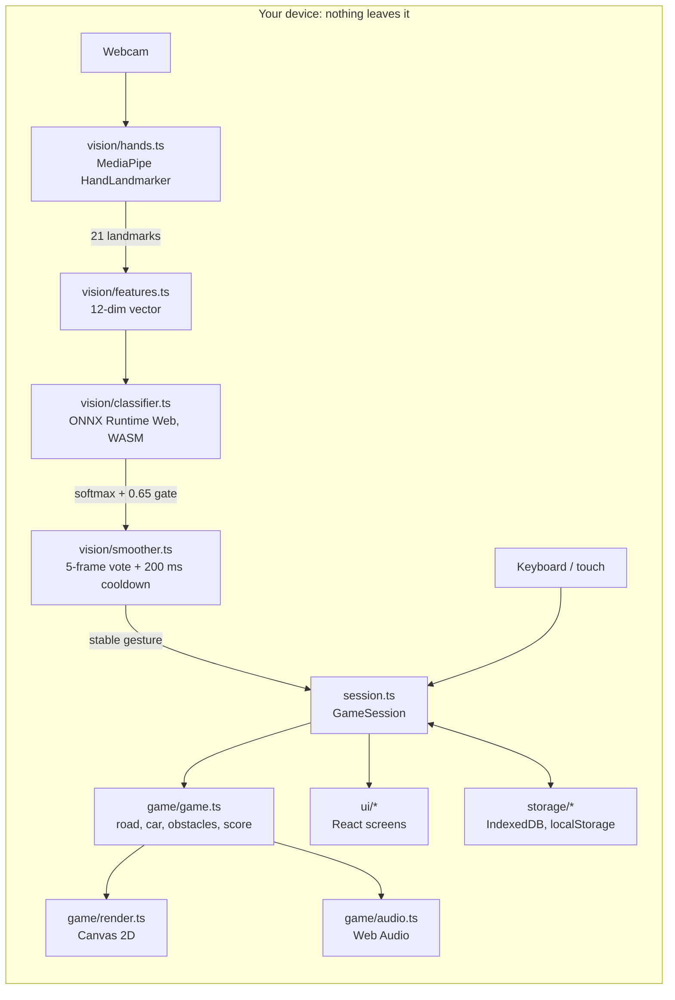
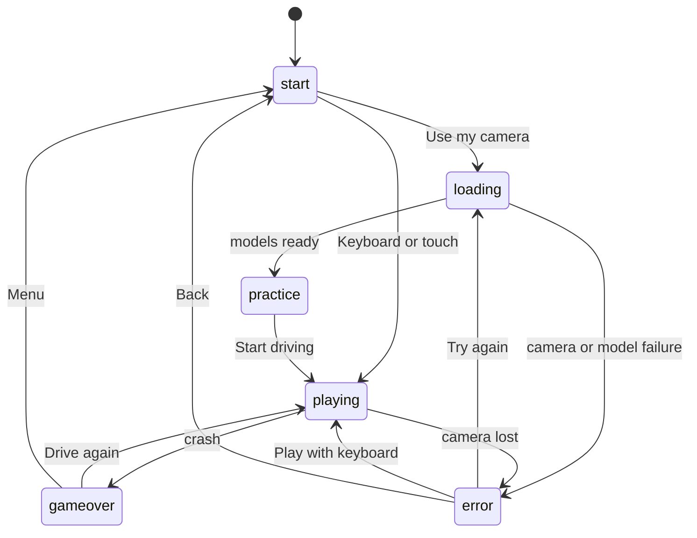
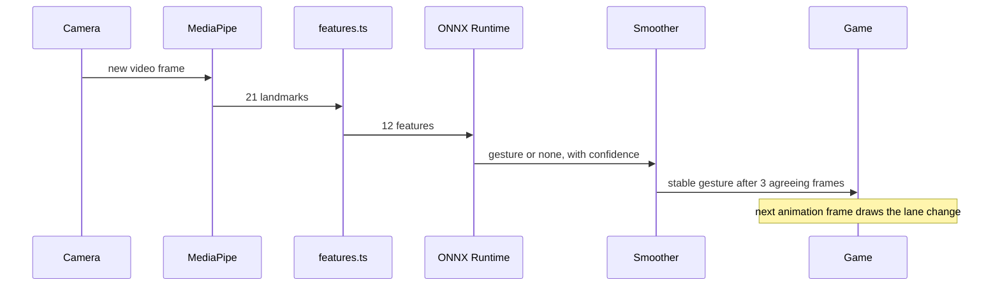

# GestureRacer

An endless racing game you steer with your hand. Tilt an open palm left or right to change lane, make a fist to jump. It runs **entirely in your browser**: no backend, no analytics, no uploads, and no video ever leaves your device.

- **Camera mode**: MediaPipe tracks your hand, a tiny ONNX model classifies the pose, the car obeys.
- **Keyboard / touch mode**: arrows or WASD plus Space on a keyboard; on a touch screen the outer thirds steer and the middle jumps. Works with no model and no camera.
- Speed ramps up, obstacles get denser, best score is stored on your device.
- Smooth and quick to start: the camera models download in the background while you read the menu, with a real progress bar if you are faster than they are. See [Performance and loading](#performance-and-loading).

> **Status.** Camera mode works out of the box using **built-in geometric rules** (tilt your open hand, make a fist). For better accuracy, train the ML model on your own recordings: [`ml/README.md`](ml/README.md), about 10 minutes of recording plus two commands. When the trained model is present it is used automatically. See [Verification status](#verification-status) for what has and has not been tested.

## Contents

1. [How to run](#how-to-run) · 2. [Stack and why](#stack-and-why) · 3. [Architecture](#architecture) · 4. [Gesture classifier](#gesture-classifier) · 5. [Performance and loading](#performance-and-loading) · 6. [Latency budget](#latency-budget) · 7. [Measured metrics](#measured-metrics) · 8. [Privacy](#privacy) · 9. [Limitations](#limitations) · 10. [Deploy](#deploy) · 11. [Verification status](#verification-status)

## How to run

Requires Node 20.11 or newer.

```bash
npm install
npm run dev          # first run downloads the ~7.5 MB hand model, then serves http://localhost:5173
```

Pick **Use my camera** or **Keyboard or touch** and play immediately. Camera mode starts with the built-in rules (the warm-up screen says "Built-in rules mode"). To switch to the trained ML model, record and train (this writes `public/models/gesture.int8.onnx`, which the app then loads on its own):

```bash
npm run collect                                   # record takes in the browser, download CSV into ml/data/
python -m venv ml/.venv && source ml/.venv/bin/activate
pip install -r ml/requirements.txt
python ml/train.py --data ml/data
python ml/export_onnx.py --data ml/data
```

Other commands:

| Command | What it does |
|---|---|
| `npm test` | 139 unit tests (Vitest) |
| `python -m unittest ml/test_dataset.py` | 11 dataset tests |
| `npm run typecheck` / `npm run lint` | strict TypeScript, strict ESLint |
| `npm run build` / `npm run preview` | production build (with a Content-Security-Policy) and a local server for it |

The camera needs a secure context: `localhost` and HTTPS work, plain HTTP does not.

## Stack and why

| Choice | Why |
|---|---|
| **Vite + TypeScript (strict)** | Fast feedback; `strict`, `noUncheckedIndexedAccess` and type-aware ESLint catch the class of bugs (off-by-one, undefined landmarks) this code is prone to. |
| **React** for menus/HUD only | Screens and settings are naturally declarative. The 60 fps game stays out of React: it lives in `GameSession`, and React re-reads it about 10 times a second. |
| **Canvas 2D** for the game | Three lanes, a few sprites. WebGL would add complexity with no visible gain. Fixed 480×720 logical world scaled to the screen. |
| **MediaPipe Tasks Vision** (HandLandmarker) | Accurate 21-point hand tracking in the browser, GPU delegate with CPU fallback. Self-hosted, not loaded from a CDN. |
| **ONNX Runtime Web, WASM backend only** | One small model; WASM runs it in ~0.1 ms. WebGPU would be slower here and adds a failure mode. Single-threaded because GitHub Pages cannot send the headers threads need. |
| **PyTorch → ONNX → INT8** | Standard path; training is a few seconds on a CPU. |
| **Web Audio**, procedural | No audio files to download or license. |
| **IndexedDB** (best score) | As specified; with an in-memory fallback if storage is blocked. Settings use `localStorage`. |
| **Vitest + fake-indexeddb** | Same config as the app; real transaction logic tested without a browser. |
| **GitHub Pages via Actions** | Static hosting, HTTPS (required for the camera), free. |

More detail and the reasoning behind each threshold: [`docs/decisions.md`](docs/decisions.md).

## Architecture



Screens (`session.ts` owns the state machine, `App.tsx` just renders it):



```
src/
  constants.ts            every threshold, grouped, each with its assumption
  types.ts, logger.ts     shared types and the only module allowed to use the console
  session.ts              orchestrator: loop, camera pipeline, game, audio, storage
  vision/  hands.ts  features.ts  classifier.ts  rules.ts  model.ts  smoother.ts  loader.ts  pipeline.ts
  game/    game.ts  loop.ts  road.ts  car.ts  obstacles.ts  score.ts  render.ts  audio.ts
  ui/      StartScreen.tsx  HUD.tsx  GameOver.tsx  Settings.tsx  StatusOverlay.tsx  gestures.tsx
  storage/ bestScore.ts  settings.ts
  tools/   collect.ts     dev-only data recorder (not in the production bundle)
ml/        collect.html  dataset.py  train.py  export_onnx.py  test_dataset.py  README.md
tests/     features  smoother  collision  game  classifier  hands  storage
docs/      latency-budget.md  decisions.md
```

Design rule worth knowing: the game (`game/`) knows nothing about cameras or the DOM. It receives a `Gesture` and a time step. The keyboard and the hand tracker therefore drive the same code path, and the game is unit-testable (including a bot that plays it for 90 simulated seconds).

## Gesture classifier

**Gestures.** LEFT = open palm tilted left, RIGHT = open palm tilted right, JUMP = fist. Left and right are as seen in the mirrored preview, so they match what you see on screen.

**Features (12, all bounded, all computed by `vision/features.ts`).**

| # | Feature | Meaning |
|---|---|---|
| 0, 1 | `roll_sin`, `roll_cos` | tilt of the wrist→middle-knuckle axis from vertical (sin/cos avoids the ±π wrap) |
| 2, 3 | `wrist_x`, `wrist_y` | wrist position in the mirrored frame, 0..1 |
| 4 | `palm_scale` | palm length relative to a reference, a distance proxy |
| 5–9 | `curl_thumb … curl_pinky` | joint angle mapped to 0 (straight) … 1 (folded); angle-based, so size-invariant |
| 10 | `finger_spread` | index-tip to pinky-tip distance over knuckle width |
| 11 | `hand_openness` | mean fingertip-to-wrist distance over palm length |

Raw landmark coordinates are deliberately not fed to the model: ratios and angles generalise across hand sizes, distances and camera shapes (x and z are scaled by the video aspect ratio so 4:3 and 16:9 cameras agree).

**Model.** MLP 12 → 32 → 16 → 3 (about 1,000 parameters), trained in PyTorch with class-weighted loss and light augmentation (feature noise, small roll jitter). Input scaling is **folded into the first layer** at export, so the browser feeds raw features to a graph of plain MatMul/Add/Relu. Output is logits; softmax runs in TypeScript.

**Evaluation.** Train/val/test are split **by recorded take, never by row**: neighbouring frames are near-identical, and a row split would leak them into the test set and inflate accuracy. `train.py` reports test accuracy, per-class precision/recall/F1, a confusion matrix and *gated* accuracy (only frames at or above the app's 0.65 confidence).

**Built-in rules (fallback).** If no trained model can be loaded, `vision/rules.ts` classifies the same 12 features with fixed rules: an *open* hand (mean finger curl below 0.5) tilted more than about 18° is LEFT or RIGHT, a *closed* hand (mean curl above about 0.6) is JUMP, and anything in between, or an upright resting hand, is "no gesture". The thresholds are the `RULES` group in `src/constants.ts`. The pipeline, smoother and game are identical in both modes; the warm-up screen and Diagnostics say which one is active, so a missing model is never silent. The rules are a sensible default, not tuned on real hands: expect to adjust `RULES` or train the model.

**No NEUTRAL class.** With three classes the model must always pick one. A relaxed, upright palm falls between LEFT and RIGHT with split probabilities, so the 0.65 confidence gate turns it into "no gesture". This is the weakest assumption in the design; if resting hands trigger moves in practice, record a fourth "neutral" class (see `docs/decisions.md`).

**Runtime filtering (`smoother.ts`).** A 5-frame majority vote (3 agreeing frames) removes single-frame flicker; a 200 ms cooldown caps actions at 5 per second and swallows LEFT↔RIGHT bounce while the hand passes through the middle. Releasing the gesture is never delayed.

**INT8.** Dynamic INT8 quantisation is applied as specified. Measured on a stand-in model of the same architecture: 3,153 bytes versus 4,315 for fp32, and no speed difference. Browser INT8 probabilities differed from Python's by up to 0.022 (top choice always identical), while fp32 matched to 3e-7. `export_onnx.py --also-fp32` ships a float model too.

## Performance and loading

**What was slow, and why.** Two separate things, both measured:

1. *Not smooth.* Profiling the page in isolation showed the whole page dropping from 60 fps to about 26 fps (half of all frames over 20 ms) even on the start screen. The cause was not the game or the canvas: it was two decorative background glows drawn with CSS `filter: blur(70px)`. A blur on screen-sized elements is re-rendered whenever anything on the page repaints, and the game canvas repaints 60 times a second. Replacing them with plain radial gradients (identical look, no filter) restored 60 fps with no slow frames. Removing the blur on the menu overlays, caching the static road in an off-screen canvas, and using an opaque canvas context are smaller wins on top of that.
2. *Slow to start.* Camera mode needs about 22 MB (MediaPipe's WebAssembly plus the hand model) and a start-up. Before, none of that began until you clicked "Use my camera", and it ran one step after another (permission prompt, then download, then start). Without a trained model the app also downloaded and started the 15 MB ONNX Runtime only to find there was no model to run.

**What changed.**

| Change | Effect |
|---|---|
| Blurred glows replaced by gradients; static layers cached; opaque canvas | 60 fps menus and gameplay instead of about 26 to 40 fps (software-rendering test, see below) |
| Models download in the background about 1.2 s after the page opens, when the browser is idle | Usually ready before you click; skipped on Save-Data or 2G/3G connections, and **Settings → Preload models** turns it off |
| Camera permission and model download run at the same time | The permission prompt no longer delays the download |
| Real progress bar (bytes downloaded, then "Starting hand tracker") | You can see it working, with an honest "about 22 MB the first time" note |
| Models are loaded once and kept; the camera is released in the menu, the models are not | Going Menu → camera again does not reload anything |
| The gesture model file is fetched first; ONNX Runtime (15 MB) loads only if the file exists | No trained model: 15 MB less to download and no start-up cost; the built-in rules take over instantly |
| Adaptive tracking: if hand detection averages over 14 ms, every 2nd camera frame is analysed and the vote window shrinks from 5 to 3 | A slow machine keeps a smooth game at a similar response time; Diagnostics shows "Tracking: every 2nd frame" |

**Honest limits.** Hand detection runs on the main thread, in the same frame as drawing. On a machine where it is slow, adaptive tracking halves the cost but does not remove it; the complete fix is to run MediaPipe in a Web Worker. I did not do that without being able to test it against a real camera and the hand model, because a broken worker would break the game. Settings → Diagnostics shows the numbers (Detect ms, camera fps, render fps, "Tracking"); if "Detect" stays above about 15 ms on your machine, that is the sign the worker is worth building.

**Realistic expectations.** `npm run dev` serves unminified, uncompressed files and runs React in development mode, so it always feels slower than the deployed site. Use `npm run build && npm run preview` to judge real speed. The first visit downloads about 22 MB (plus ONNX Runtime's 15 MB only if you ship a trained model); the browser caches it afterwards.

**How the numbers were measured.** Headless Chromium with software rendering, one CPU core, same machine for every run, 3 s of `requestAnimationFrame` timestamps per case. Real GPUs will be faster in absolute terms; the cause-and-effect (blur filter versus gradients) was isolated by switching one thing at a time.

| Case | Mean frame | Frames over 20 ms |
|---|---|---|
| Blank page (control) | 16.9 ms | 2 of 147 |
| App with blurred glows | 38.4 ms | 60 of 63 |
| App, glows hidden | 16.7 ms | 0 of 148 |
| App, glows as gradients (shipped) | 16.7 ms | 0 of 148 |
| Menu, shipped build | 16.7 ms | 0 of 178 |
| Gameplay, shipped build | 16.9 ms | 2 of 176 |
| Warm-up and gameplay with live camera preview | 17.1 / 17.6 ms | 4 of 144 / 4 of 140 |

## Latency budget

Full breakdown with sources: [`docs/latency-budget.md`](docs/latency-budget.md).



| Stage | Budget | Basis |
|---|---|---|
| Camera to JS frame | 40–110 ms | estimate (33 ms frame interval + driver pipeline); not measurable from JS |
| Hand detection | ≤ 15 ms | **to measure** (Settings → Diagnostics) |
| Features | negligible | arithmetic on 21 points |
| ONNX inference | < 15 ms (brief) | ≈ 0.1 ms measured (stand-in model) |
| Smoother vote | 66 ms at 30 fps | by design: 2 extra frames after the first matching one |
| Render | ≤ 17 ms | next 60 Hz frame |
| **Pose held → car starts moving** | **≈ 130–210 ms** | sum of the above; **estimate, not measured end to end** |

A one-lane dodge also needs the lane change itself (95 % complete in 0.17 s) and human reaction time. At top speed a row is visible 0.93 s before impact, so the budget leaves roughly 0.3 s of margin.

## Measured metrics

"Measured" means measured by me in a Linux sandbox with headless Chromium, which has no GPU and no real camera. Rows marked **to fill** need your machine and your recordings.

| Metric | Value | Status |
|---|---|---|
| Test accuracy, real hands (target > 92 %) | **to fill** | run `ml/train.py` |
| INT8 vs fp32 test accuracy | **to fill** | `ml/export_onnx.py --data` |
| Hand detection time, GPU / CPU delegate | **to fill** | Settings → Diagnostics |
| Classifier time in browser | ≈ 0.1 ms median, ≤ 0.5 ms p95 | measured, stand-in model; timer-resolution limited |
| Pose → car moves, end to end | est. 130–210 ms | estimate only |
| Model size | 3,153 B INT8 / 4,315 B fp32 | measured, stand-in model; your export reports the real size |
| App JS, gzip | 154 KB (React 68, MediaPipe 45, ORT 24, app 15) + 3.6 KB CSS | measured (`vite build`) |
| ONNX Runtime WASM | 14.8 MB (3.9 MB gzip) | measured |
| MediaPipe WASM | 14.5 MB (4.1 MB gzip) | measured |
| Hand model download | ≈ 7.5 MB | Google's figure, not measured here |
| Game render time | 0.15 ms per frame | measured, headless software rendering; real GPU to fill |
| Unit tests | 139 TypeScript + 11 Python, all passing | measured |
| Frame time, menu and gameplay (software rendering) | 16.7 ms mean, 0 to 2 slow frames of about 177 | measured, see [Performance and loading](#performance-and-loading) |
| Frame time before the fix (same test) | 38.4 ms mean, 60 of 63 frames slow | measured |
| Fairness bot | survives 90 s on 20 of 20 seeds | measured (150 ms reaction, one move per 200 ms) |

Camera mode downloads about 22 MB on the first visit (MediaPipe's 14.5 MB WebAssembly and the 7.5 MB hand model), and roughly 12 MB if the host compresses `.wasm` files (not verified for GitHub Pages). ONNX Runtime's 15 MB WebAssembly is fetched **only** when a trained model is installed. Everything is cached afterwards.

## Privacy

- Camera frames are processed **on your device** by MediaPipe and ONNX Runtime running in your browser. They are never uploaded, stored or sent anywhere.
- There is no backend, no analytics, no third-party scripts, no CDN: models and WASM are served from the same origin.
- The production build ships a Content-Security-Policy with `connect-src 'self'`, so the browser itself blocks requests to any other site, even from a buggy dependency.
- The only data kept is your **best score** (IndexedDB) and three **settings** (`localStorage`), both on your device.
- The camera is released when you return to the menu, if it is lost, or when you leave the page. The browser's camera indicator shows when it is on.
- The training recorder stores 12 numbers per frame, never images.

## Limitations

- **One hand, one player.** Only the first detected hand is used.
- **Tilt needs visible fingers.** A palm pointing straight at the camera has no usable tilt and is treated as "no gesture". Poor light, occlusion or a busy background lowers tracking quality.
- **No NEUTRAL class.** Resting poses are rejected only by the confidence gate (see above); in rules mode by the tilt dead zone.
- **Rules mode is untuned.** Its thresholds come from geometry, not from recordings of real hands.
- **Accuracy depends on your data.** A model trained on one person in one room will be weaker for others. Record varied takes ([`ml/README.md`](ml/README.md)).
- **Pre-SIMD browsers are unsupported** (they get the model-load error screen).
- **Hand detection shares the main thread with the game.** Adaptive tracking protects smoothness on slow machines, at the cost of a lower gesture rate; a Web Worker is the next step if Diagnostics shows slow detection.
- **Cross-runtime INT8 differences**: small probability differences between Python and the browser; use fp32 if it matters.
- **Perceived latency has a floor** of a couple of hundred milliseconds from camera pipeline and voting; the game is paced for it (rows are spaced and capped in speed accordingly) but it is not a twitch game.
- **Browsers**: only Chromium has been exercised. Firefox, Safari (including iOS audio and camera behaviour) and real phones are untested.
- **Screen readers**: menus are accessible; the canvas game itself is not.

## Deploy

Static site on GitHub Pages, built by `.github/workflows/deploy.yml`.

1. Train and export the model, then **commit `public/models/gesture.int8.onnx`**. Without it the deployed game runs on the built-in rules; CI prints a warning (not a failure) so you notice. (`ml/data/` and checkpoints are git-ignored on purpose; the hand model and WASM are fetched at build time.)
2. Commit `package-lock.json` (the workflow uses `npm ci`).
3. Push to GitHub, then **Settings → Pages → Build and deployment → Source: GitHub Actions**.
4. Push to `main`. The workflow lints, type-checks, tests and builds with `BASE_PATH=/<repo-name>/`, then publishes `dist/` to `https://<user>.github.io/<repo-name>/`.

For a user/organisation site or custom domain served from `/`, remove the `BASE_PATH` line in the workflow. Preview the production build locally with `npm run build && npm run preview`.

## Verification status

**Verified** (headless Chromium in a sandbox, plus unit tests):
type-check, lint and build are clean; 139 TypeScript and 11 Python tests pass, and deliberately breaking the code in eighteen places (flipped roll sign, removed mirroring, disabled cooldown, removed the dead zone or the model fallback, and so on) makes the tests fail. The camera pipeline is tested end to end with a scripted camera and tracker: held poses become exactly one gesture each, in rules mode. The classifier ran in ONNX Runtime Web in dev and in the production build under the CSP. Camera success and every error path were exercised with a fake camera. The full UI flow (start, warm-up, play, pause when the hand is lost, game over, settings, persistence across reload, the model-load error screen, camera release) was driven with a scripted vision source and keyboard input.

**Not verified: please check on your machine first.**
- MediaPipe hand tracking on a real camera inside my tests (the sandbox cannot download the model). In your own run the hand model did load, which is what exposed the missing gesture model.
- MediaPipe under the production CSP.
- `ml/train.py` and the PyTorch half of `ml/export_onnx.py` (PyTorch could not be installed in the sandbox; the INT8 half was verified with an equivalent model built by scikit-learn).
- Accuracy and latency on real hands (including how well the built-in rules suit your hand and camera), GPU rendering performance, Firefox, Safari, mobile.
