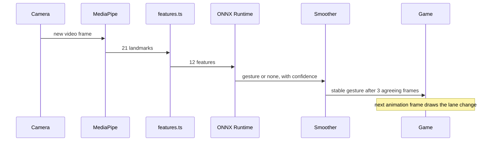

# Latency budget

Question this answers: **from the moment the player holds a pose, how long until the car starts to move, and is that fast enough for the game?**

Legend: **measured** = timed by me (headless Chromium in a Linux sandbox, no GPU, no real camera); **estimate** = reasoned, not timed; **to measure** = needs your machine.

## 1. The path of one gesture

## 2. Stage by stage

| # | Stage | Budget | Status | Notes |
|---|---|---|---|---|
| 1 | Camera exposure, driver, browser decode, until the frame is readable by JS | 40–110 ms | estimate | One frame interval is 33 ms at 30 fps; the rest is driver and OS buffering. JavaScript cannot observe it. Cheap webcams in low light drop to 15 fps, which doubles the frame interval. |
| 2 | MediaPipe HandLandmarker (`detectForVideo`) | ≤ 15 ms | **to measure** | Settings → Diagnostics → "Detect". Depends heavily on GPU vs CPU delegate (also shown). Measured on the main thread, so it competes with rendering. |
| 3 | `extractFeatures` | negligible | estimate | About 100 floating-point operations on 21 points; allocates one 12-float array. |
| 4 | ONNX inference | < 15 ms (project brief) | measured: ≈ 0.1 ms median, ≤ 0.5 ms p95 | Stand-in model of the same architecture (12-32-16-3), WASM backend, single thread, in headless Chromium. `performance.now()` granularity limits the precision. Settings → Diagnostics → "Classify" shows the real value. |
| 5 | Smoother majority vote | 66 ms at 30 fps | by design | 3 of 5 frames must agree, so the stable gesture appears 2 frame intervals after the first matching frame. At 15 fps this becomes 133 ms. |
| 6 | Game applies the gesture | < 1 frame | by design | Runs inside the same frame loop; no queue. |
| 7 | Lane change animation | 95 % complete in 0.17 s | by design | Exponential ease with rate 18/s: t = ln(20)/18. Movement is visible on the first frame. |
| 8 | Render and display | ≤ 17 ms | estimate | The next 60 Hz frame, plus display latency (not observable). |

**Pose held → car starts to move** ≈ 1 + 2 + 3 + 4 + 5 + 8 ≈ **130–210 ms** (estimate). **Lane change visually complete** ≈ another 170 ms, so roughly **300–380 ms**.

**The cooldown is not latency.** The 200 ms cooldown after an emitted gesture limits the *rate* of actions (at most 5 per second). The first gesture after a quiet period is never delayed by it.

**Dropped frames, not queued frames.** If the classifier is still running when the next camera frame arrives, that frame is skipped (`GestureClassifier.busy`). With a 0.1 ms model this should never happen; the rule exists so a slow device degrades into lower gesture rate rather than growing lag.

**Pauses cannot teleport the car.** The loop clamps each step to 50 ms, so a background tab or a garbage-collection pause cannot jump the world forward.

## 2b. Load and frame-time effects

- **Detection cost and smoothness.** Stage 2 runs on the main thread in the same frame as drawing. If it averages over 14 ms the pipeline analyses every 2nd camera frame and shortens the vote from 5 to 3 frames: the vote then takes 2 analysed frames at about 15 Hz, roughly 133 ms. Budget stage 5 as 66 ms normally and up to about 133 ms in this mode. That is the price of keeping the game at 60 fps on a slow machine; running MediaPipe in a Web Worker would avoid it (see `docs/decisions.md`, D34).
- **First use.** The 22 MB of camera models used to load only after the click, one step after another. They now start downloading about 1.2 s after the page opens, and camera permission and downloading overlap. None of this changes gesture latency once playing; it changes the time to first play.

## 3. Is that fast enough? Game-side check

Rows appear at the top of the screen and reach the car after `540 px / speed` (the car's top edge is at y = 540 in the 720-px-tall world):

| Speed | Row visible before impact |
|---|---|
| Start, 260 px/s | 2.08 s |
| Top, 580 px/s | **0.93 s** |

At top speed, one lane change needs:

| Item | Time | Basis |
|---|---|---|
| Human reaction to seeing the row | ≈ 0.25 s | assumption (typical simple visual reaction time) |
| Gesture pipeline, pose to car moving | ≈ 0.13–0.21 s | section 2 |
| Lane change to clear the obstacle | ≈ 0.17 s | section 2, row 7 |
| **Total** | **≈ 0.55–0.63 s** | |
| **Margin** | **≈ 0.3 s** | 0.93 s − 0.63 s |

This is why:
- top speed is capped at 580 px/s (an earlier 620 left too little margin);
- the spawner never asks for a two-lane dodge: it guarantees a free lane within **one** lane of wherever the player can be (see `docs/decisions.md`, "Fairness rules");
- the top 90 px of the screen fades only slightly, so the first moments of warning are not hidden.

A scripted bot with a 150 ms reaction and one move per 200 ms survives 90 simulated seconds on all 20 test seeds. That validates the *spawning rules*, not human performance.

## 4. If it feels laggy

| Symptom | Likely cause | What to try |
|---|---|---|
| Car responds about half a second late | Camera running at 15 fps in low light | Add light; check "Camera" fps in Diagnostics |
| Inconsistent response | Hand detection on the CPU delegate | Diagnostics shows "Hand model: CPU"; close other GPU-heavy tabs, update the browser or GPU driver |
| Gestures register but feel mushy | Vote window too long for your camera | Lower `SMOOTHER.windowSize` to 3 (needs 2 frames) in `src/constants.ts`; costs some stability |
| Frequent accidental moves | Confidence gate too low or no neutral class | Raise `CLASSIFIER.minConfidence`, or record a neutral class |

## 5. How to measure end to end

The in-app Diagnostics give stages 2 and 4 plus camera fps. Stages 1 and 8 cannot be seen from JavaScript, so measure the whole path from outside:

1. Film your hand and the screen together with a phone at 120 or 240 fps.
2. Count frames between the hand starting to tilt and the car starting to move; divide by the frame rate.
3. Repeat 10 times; report the median and the worst case in the README metrics table.
